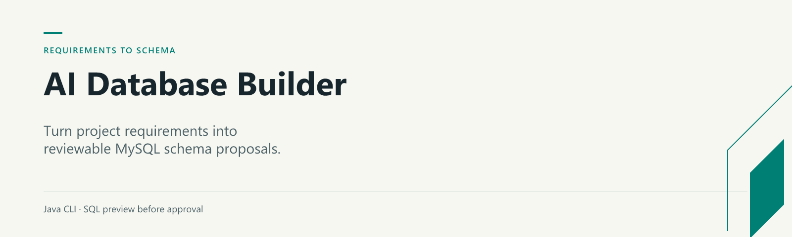

# AI Database Builder



**Turn project requirements into a database proposal you can review.**

A Java command-line tool that uses Gemini to propose a MySQL schema from a natural-language project brief. It validates the design and prints the SQL before any database operation. Creation requires both `--apply` and an explicit confirmation.

## Try it without an API key or database

Requirements: Java 17 and Maven 3.9+.

```sh
mvn --batch-mode verify
java -jar target/ai-database-builder-0.1.0-SNAPSHOT.jar --example
```

The bundled fictional example proposes a `projects` table with an ID, title and creation timestamp. **Preview mode makes no database connection.**

## Generate a proposal

Export `GEMINI_API_KEY` in your shell, then run the JAR without arguments. `GEMINI_MODEL` selects the model; its default is `gemini-3.8-flash`. Check [Google's model documentation](https://ai.google.dev/gemini-api/docs/models) for availability in your account. Requests send the project description to Google's Gemini API and may consume quota.

Configuration names are documented in [`.env.example`](.env.example). The Java application reads environment variables; it does not load `.env` automatically. Never put credentials in source files.

## Review and create

You can also review a saved design:

```sh
java -jar target/ai-database-builder-0.1.0-SNAPSHOT.jar --design design.json
java -jar target/ai-database-builder-0.1.0-SNAPSHOT.jar --design design.json --apply
```

For creation, export `MYSQL_HOST`, `MYSQL_PORT`, `MYSQL_USER` and `MYSQL_PASSWORD`. Inspect the SQL and type `yes` when prompted. Use a disposable database server first. The tool creates a **new** database and stops on the first error; it does not overwrite an existing database. MySQL DDL is not transactional, so a failed run can leave partially created objects for inspection.

## Design boundaries

- Names use ASCII letters, digits and underscores, up to 64 characters.
- Types are allowlisted: common numeric/text/date types, `VARCHAR(n)` and `DECIMAL(p,s)`.
- A proposal supports up to 50 tables and 100 columns per table.
- Relationships, indexes, keys, constraints and migration planning require further design work; this is a schema prototyping tool.
- A valid response is not necessarily a good data model. Review normalization and business rules yourself.

## Verification

Unit tests cover request escaping, response parsing, SQL validation, approval cancellation and failure handling. CI additionally creates and removes an isolated test database on a disposable MySQL service. No live Gemini request is required for tests.

[License](LICENSE) · [Moayad Alshehry](https://github.com/MoayadAlshehry)
